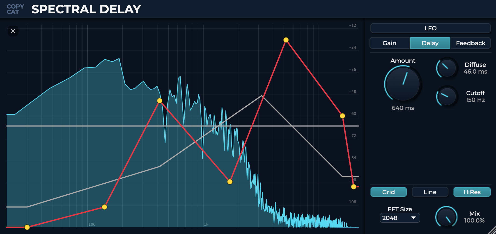
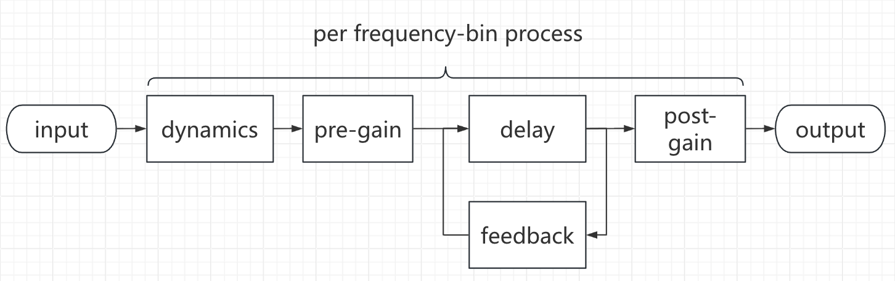
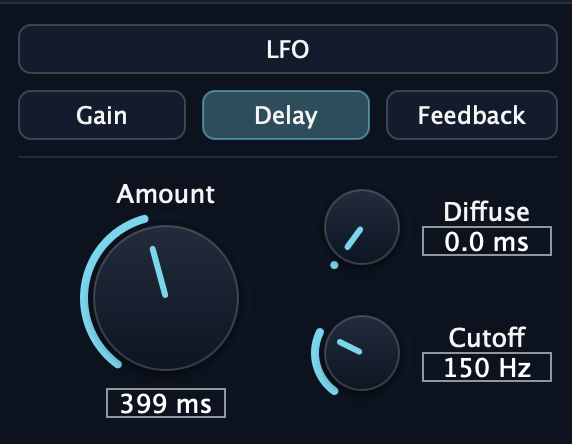
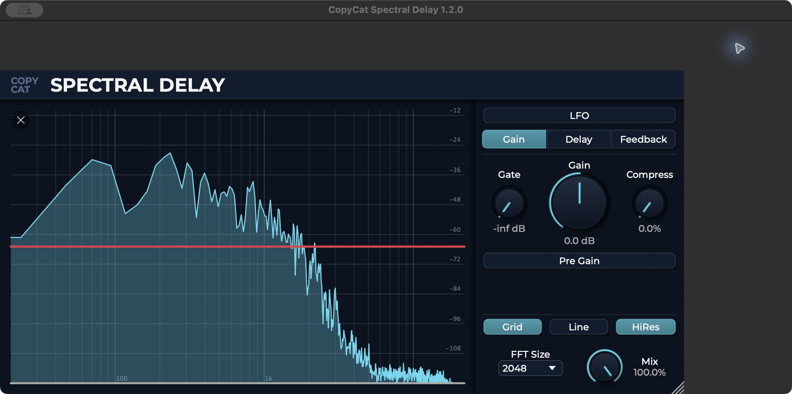
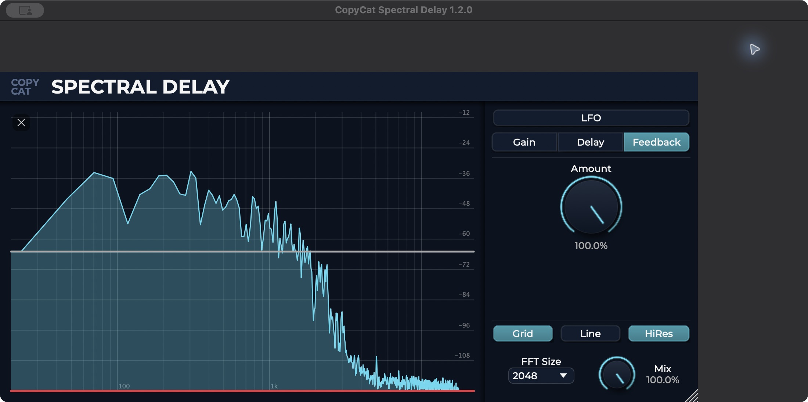
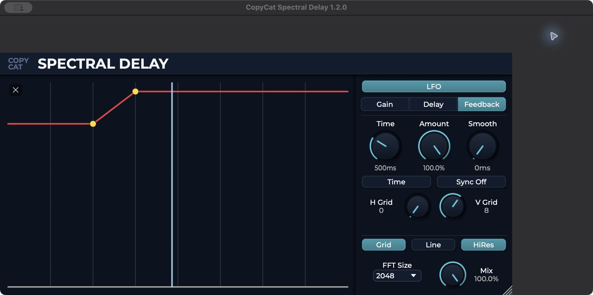

# CopyCat Spectral Delay

---

A stereo audio effect built with C++17 and JUCE 8. Frequency curves control delay,
gain and feedback independently across STFT bins, with spectral dynamics and LFO
modulation for evolving textures. Suitable for shaping dynamics, time and feedback independently across the frequency spectrum.



---

## Audio demos

Compare the original input (Dry) with the processed output (Wet).

| Demo | Dry | Wet |
| --- | --- | --- |
| Piano — long delay / shimmer | [Original piano](docs/Audio/1piano_dry.mp3) | [Processed piano](docs/Audio/1piano_wet.mp3) |
| Drum loop — dispersion / high-feedback metallic texture | [Original drum loop](docs/Audio/2_drum_dry.mp3) | [Processed drum loop](docs/Audio/2_drum_wet.mp3) |
| Hi-tech bass — complex settings / experimental glitch | [Original bass](docs/Audio/3_complex_dry.mp3) | [Processed bass](docs/Audio/3_complex_wet3.mp3) |

## DSP Process



### [1] Delay



- **Per frequency-bin delay -** Up to **2000 ms**
- Free drawing delay curve
- **Diffuse knob** - atmospheric stereo texture.

### [2] Dynamics



- Gain knob: toggle between pre/post delay
- Free drawing gain curve
- **Spectral gate effect**
- **Simple per-bin compress** - input loudness tracking, “S” shape dynamic processing

### **[3] Feedback**



- Free drawing feedback curve

### **[4] LFO**



- Gain, Delay and feedback amount modulation
- Free drawing curve
- Smooth function
- Intuitive grid settings


## Build from source

Use **CMake 3.22+**, a C++17 compiler, and the **JUCE 8.0.12 source tree**.
JUCE is an external dependency; it is not vendored into this repository.

```sh
git clone https://github.com/CopycatMusic/SpectralDelay.git
cd SpectralDelay
git clone --depth 1 --branch 8.0.12 https://github.com/juce-framework/JUCE.git JUCE
```

macOS (Xcode command-line tools required):

```sh
cmake -S . -B build -DCMAKE_BUILD_TYPE=Release -DJUCE_DIR="$PWD/JUCE"
cmake --build build --config Release --parallel 4
```

macOS defaults to `arm64;x86_64`. For a faster build on Apple Silicon, add
`-DCMAKE_OSX_ARCHITECTURES=arm64`; use `x86_64` for an Intel-only build.

Windows (Visual Studio 2022 with Desktop development with C++ installed):

```powershell
cmake -S . -B build -G "Visual Studio 17 2022" -A x64 -DJUCE_DIR="$PWD/JUCE"
cmake --build build --config Release --parallel 4
```

These commands build directly with CMake; no packaging or signing script is required.
The local `JUCE/` checkout is ignored by Git.

The project builds one plugin with all features enabled. To build VST3 explicitly:

```sh
cmake --build build --config Release --target CopyCatSpectralDelay_VST3
```

Outputs are in `build/CopyCatSpectralDelay_artefacts/Release/`. Builds do not install plugins
by default. Opt in with `-DCOPYCAT_COPY_PLUGIN_AFTER_BUILD=ON`, or manually copy
bundles into the host's plugin folder.

CMake is the supported build entry point.

## Install and try

Download **1.2.0** from the [GitHub Release](https://github.com/CopycatMusic/SpectralDelay/releases/tag/v1.2.0-release):

- **macOS:** universal AU and VST3 bundles for Apple Silicon and Intel Macs.
- **Windows:** x64 VST3 bundle.

The plugin is distributed as one version with all features enabled.
[Gumroad](https://copycatmusic.gumroad.com/l/spectral_delay) is an alternate distribution page;
check its download version separately.
Historical downloads remain on the [Releases page](https://github.com/CopycatMusic/SpectralDelay/releases)
and the [public beta repository](https://github.com/CopycatMusic/Spectral-Delay-beta-release/releases).

Install the downloaded bundles or new source builds manually:

| Platform | Format | Plugin directory |
| --- | --- | --- |
| macOS | VST3 | `~/Library/Audio/Plug-Ins/VST3/` |
| macOS | AU | `~/Library/Audio/Plug-Ins/Components/` |
| Windows | VST3 | `C:\Program Files\Common Files\VST3\` |

Rescan plugins in your DAW after copying the bundle. macOS bundles use ad-hoc
signing and are not notarized; Windows bundles are not code-signed.

The build workflow uploads the plugin bundles as CI artifacts on
branch pushes. Pushing a `v*` tag runs both platform builds and creates a **draft
Release** with Windows VST3 and macOS AU/VST3 ZIPs. A maintainer must review and
publish the draft before it becomes a downloadable release. No installer or
signing script is required for a source build or manual installation.

See [validation status](docs/VALIDATION.md) and [engineering notes](docs/ENGINEERING_REVIEW.md)
for the checks performed and known limitations.

## References and licensing

STFT processing is based on [hollance/fft-juce](https://github.com/hollance/fft-juce).
The plugin uses [JUCE](https://github.com/juce-framework/JUCE) and Montserrat fonts.
See [THIRD_PARTY_NOTICES.md](THIRD_PARTY_NOTICES.md) for their licensing and provenance.

The author's project code remains **All Rights Reserved**, as in the previous
README. Public visibility does not change that policy. A project-wide open-source
licence has not been selected; third-party components retain their own licences.


## About

Feel free to contact me at:
tg3299182383@gmail.com

[Bilibili](https://space.bilibili.com/480123855)
